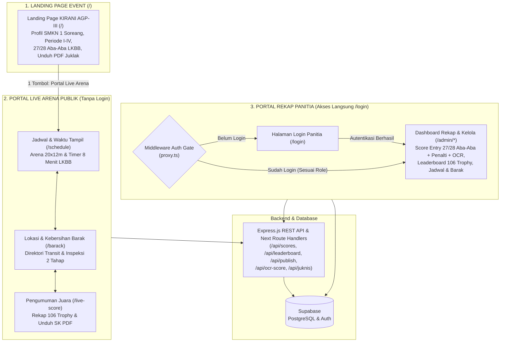
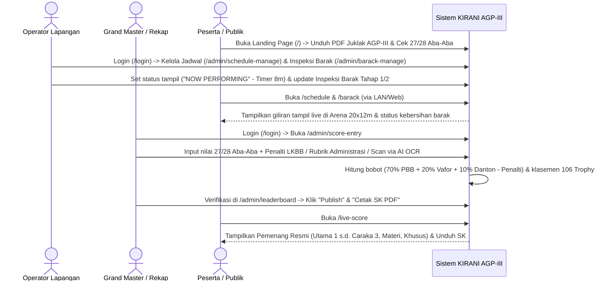
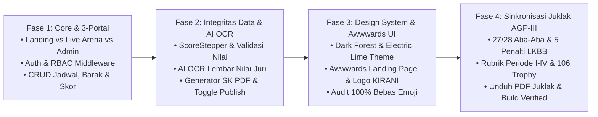

# Product Requirements Document (PRD): Sistem Rekapitulasi Nilai & Manajemen Kompetisi KIRANI AGP-III SMKN 1 Soreang

| Informasi Dokumen | Detail |
| :--- | :--- |
| **Nama Aplikasi** | KIRANI AGP-III (Sistem Rekapitulasi Nilai & Manajemen Kompetisi Aktivitas Gerakan Pramuka Ke-III) |
| **Penyelenggara Resmi** | Sangga Kerja Ambalan Ki Hajar Dewantara & R.A Kartini (`04.105–04.106`) Pangkalan **SMK Negeri 1 Soreang** (Jl. Nyalindung No. 1, Kec. Soreang, Kab. Bandung) |
| **Versi Dokumen** | 1.2 (Final Synchronized — Juklak AGP-III SMKN 1 Soreang & 106 Trophy System) |
| **Status** | Production-Ready (Seluruh Fase 1–4 Selesai) |
| **Tech Stack Utama** | Next.js 16 (App Router), Express.js (TypeScript), Supabase (PostgreSQL & Auth), Tailwind CSS, Framer Motion, Lucide React |
| **Target Pengguna** | Panitia Inti (Grand Master & Operator Rekap), Operator Lapangan, Dewan Juri, serta Peserta, Pembina & Pengunjung Publik |

---

## 1. Latar Belakang & Masalah (Background & Problem Statement)

Penyelenggaraan **Lomba Aktivitas Gerakan Pramuka Ke-III (AGP-III) Se-Jawa Barat Open** di Pangkalan **SMK Negeri 1 Soreang** melibatkan kuota hingga **50 Basis** dari 3 golongan pendidikan (**Golongan A: Penggalang SD/MI**, **Golongan B: Penggalang SMP/MTs**, dan **Golongan C: Penegak SMA/SMK/MA Sederajat**), dengan rangkaian mata lomba **Periode I s.d. Periode IV**, rincian **27/28 Aba-Aba LKBB** sesuai **PERPANG TNI No. 58 Tahun 2018**, serta perebutan total **106 Trophy**.

**Masalah utama pada sistem konvensional/manual:**
1. **Rawan Human Error & Lambat:** Input dan rekapitulasi nilai dari lembar kertas juri ke spreadsheet manual (terutama penggabungan bobot LKBB **70% PBB + 20% Variasi & Formasi + 10% Danton** serta potongan penalti lapangan) berisiko salah hitung dan memakan waktu lama sebelum pengumuman juara dapat dipublikasikan.
2. **Kurangnya Transparansi & Akses Informasi Lapangan:** Peserta dan pembina kesulitan memantau urutan tampil yang sedang berlangsung (*real-time*) di Lapangan Utama 20 x 12 m serta mencari lokasi ruang transit/barak dan status inspeksi kebersihan barak.
3. **Kendala Koneksi Internet di Lapangan:** Lokasi perlombaan membutuhkan dukungan operasional jaringan lokal (LAN) dan penyimpanan cadangan (*fallback*).
4. **Kontrol Akses Panitia yang Bercampur:** Tanpa pemisahan hak akses (*role-based access control*), panitia lapangan berisiko mengubah data rekapitulasi nilai yang seharusnya hanya dikelola oleh tim rekapitulasi inti.

---

## 2. Tujuan Produk (Product Objectives)

1. **Akurasi & Kecepatan Rekapitulasi Sesuai Juklak AGP-III:** Mengotomatisasi perhitungan nilai per kriteria (27 Aba-Aba Golongan A & 28 Aba-Aba Golongan B/C), penalti resmi LKBB, rubrik Administrasi Regu (7 komponen), stiker waktu Mini Pionering, dan pemindaian lembar nilai via AI OCR sehingga rekap **106 Trophy** dan pencetakan Surat Keputusan (SK) selesai secara instan.
2. **Pemisahan Hak Akses yang Ketat (RBAC):** Membedakan ruang kerja antara **Grand Master / Operator Rekap** (otoritas penuh atas nilai, publikasi hasil, dan manajemen sistem) dengan **Operator Lapangan** (fokus pada manajemen antrean tampil dan alokasi/inspeksi barak).
3. **Kemudahan Akses Informasi Publik & Unduh Juklak Langsung:** Menyediakan Landing Page Awwwards-style (`/`) dengan fitur **Unduh Langsung PDF Surat Edaran & Juklak AGP-III** serta Portal Live Arena tanpa login (`/schedule`, `/barack`, `/live-score`).

---

## 3. Target Pengguna & Persona (User Personas)

| Peran Pengguna | Deskripsi & Tanggung Jawab | Kebutuhan Utama | Hak Akses Sistem |
| :--- | :--- | :--- | :--- |
| **1. Grand Master (Admin Rekapitulasi)** | Panitia inti Ambalan Ki Hajar Dewantara & R.A Kartini yang bertanggung jawab atas validitas skor, rekapitulasi akhir 106 Trophy, dan pengesahan SK Juara. | Input nilai cepat & akurat, pantau klasemen Golongan A/B/C, kontrol publikasi hasil, cetak SK PDF resmi, kelola akun panitia & backup data. | Akses penuh ke seluruh rute `/admin/*` (`/admin/score-entry`, `/admin/leaderboard`, `/admin/users`, dll.). |
| **2. Operator Lapangan** | Panitia pengatur jalannya lomba di lapangan utama (20 x 12 m) dan tim penilai area transit/barak peserta. | Memperbarui status peserta yang sedang tampil (*Now Performing*, timer 8 menit LKBB) serta mendata lokasi & inspeksi kebersihan barak Tahap 1 dan Tahap 2. | Terbatas pada operasional lapangan (`/admin/schedule-manage`, `/admin/barack-manage`, `/admin/participants`, `/admin/categories`). |
| **3. Peserta, Pembina & Pengunjung (Publik)** | Regu/Sangga peserta lomba (Golongan A/B/C), pembina pendamping, dan penonton di SMK Negeri 1 Soreang. | Mengunduh PDF Juklak AGP-III, melihat rincian 27/28 Aba-Aba LKBB, memantau giliran tampil secara *real-time*, mencari lokasi ruangan barak pangkalan, dan mengunduh SK Juara resmi. | Akses tanpa login ke Landing Page (`/`) dan Portal Live Arena (`/schedule`, `/barack`, `/live-score`). |

---

## 4. Arsitektur Pembagian 3 Pintu Web & Tech Stack

Aplikasi ini dirancang dengan pemisahan tegas menjadi **3 Pintu Akses Web (Three-Portal Architecture)** di dalam satu ekosistem Next.js App Router:

### 4.1. Pembagian Ruang Akses (Landing Page vs. Portal Live Arena vs. Portal Rekap Panitia)

| Pintu Web | Target Pengguna | Akses & Autentikasi | Halaman & Fungsi Utama |
| :--- | :--- | :--- | :--- |
| **1. Landing Page Event Umum (`/`)** (`(landing)`) | Calon Peserta, Pembina, Masyarakat Umum | **Tanpa Login (Terbuka)** | • **Landing Page Profil KIRANI AGP-III (`/`):** Berisi identitas resmi SMK Negeri 1 Soreang, Countdown Hari-H (25 April 2026), Bento Grid Mata Lomba **Periode I–IV**, Tab Interaktif **27 vs 28 Aba-Aba LKBB (PERPANG TNI No. 58/2018)** + 5 Aturan Penalti, Timeline Pendaftaran & Technical Meeting, Kontak Narahubung (Kak Redittia, Kak Bayu, Kak Naza), fitur **Unduh Langsung PDF Juklak AGP-III**, serta **1 tombol masuk ke Portal Live Arena (`/schedule`)**. |
| **2. Portal Live Arena Publik (`/schedule`, `/barack`, `/live-score`)** (Rute publik `(main)`) | Peserta Lomba, Pembina, Penonton di Lokasi | **Tanpa Login (Terbuka)** | • **Waktu & Urutan Tampil (`/schedule`):** Memantau giliran tampil regu secara *real-time* (`NOW PERFORMING`, `NEXT`, `STANDBY`) dengan timer standar 8 menit LKBB. • **Lokasi & Kebersihan Barak (`/barack`):** Mencari titik ruangan transit per pangkalan sekolah sekaligus memantau status **Inspeksi Kebersihan Barak Tahap 1 & Tahap 2 (Periode IV)**. • **Pengumuman Juara & 106 Trophy (`/live-score`):** Melihat hasil rekapitulasi akhir per Golongan A/B/C (Juara Utama 1 s.d. Caraka 3, Juara Materi, Juara Khusus) dan mengunduh SK Juara resmi (PDF). |
| **3. Portal Rekapitulasi & Manajemen Panitia (`/login` -> `/admin/*`)** (`(main)/(auth)` & `(main)/(admin)`) | Panitia Rekap (`SUPER_ADMIN` / `GRAND_MASTER`, `OPERATOR_REKAP`) & Operator Lapangan (`ADMIN` / `OPERATOR`) | **Wajib Login (`/login`)** — Setiap akses ke `/admin/*` tanpa sesi aktif **langsung diarahkan otomatis ke `/login`** oleh *Server Middleware* ([proxy.ts](file:///c:/FOLDER%20KULIAH/PROJECT%20WEB%20REKAPITULASI%20NILAI%20AGP/Rekapitulasi-Agp/frontend/src/proxy.ts)). | • **Portal Login Panitia (`/login`):** Gerbang khusus panitia dengan tombol *Quick Role Fill* (`GM`, `ADMIN`, `REKAP`). • **Dashboard & Rekapitulasi (`/admin`, `/admin/score-entry`, `/admin/leaderboard`):** Input nilai juri sesuai Juklak AGP-III (manual & scan AI OCR), kalkulator penalti LKBB, klasemen master + tab **106 Trophy Piala Bergilir**, tombol *Publish*, & cetak SK. • **Operasional Lapangan (`/admin/schedule-manage`, `/admin/barack-manage`, `/admin/participants`, `/admin/categories`):** Kelola kuota 50 Basis, jadwal tampil, dan inspeksi barak. • **Sistem & Keamanan (`/admin/users`, `/admin/roles`, `/admin/audit-logs`, `/admin/backup`, `/admin/restore`):** Kelola hak akses, log aktivitas, dan cadangan data. |

### 4.2. Diagram Arsitektur 3 Pintu Web

* **Frontend:** [package.json](file:///c:/FOLDER%20KULIAH/PROJECT%20WEB%20REKAPITULASI%20NILAI%20AGP/Rekapitulasi-Agp/frontend/package.json) — Next.js 16 (App Router dengan *Route Groups* `(landing)` dan `(main)`), React 19, TypeScript, Tailwind CSS, Framer Motion, Lucide React.
* **Backend:** [app.ts](file:///c:/FOLDER%20KULIAH/PROJECT%20WEB%20REKAPITULASI%20NILAI%20AGP/Rekapitulasi-Agp/Backend/src/app.ts) — Node.js, Express.js, TypeScript, CORS-enabled untuk akses lintas perangkat di jaringan lokal (`0.0.0.0`).
* **Database & Autentikasi:** Supabase (`@supabase/supabase-js` & `@supabase/ssr`) untuk manajemen sesi autentikasi panitia, penyimpanan skor, klasemen, jadwal, dan data barak.

---

## 5. Spesifikasi Teknis Juklak AGP-III SMKN 1 Soreang & Fitur Aplikasi

Seluruh modul aplikasi telah disinkronkan 100% dengan dokumen resmi **Surat Edaran & Petunjuk Pelaksanaan (Juklak) Lomba Aktivitas Gerakan Pramuka Ke-III Tahun 2026** ([Juklak_AGP_III_SMKN1_Soreang.pdf](file:///c:/FOLDER%20KULIAH/PROJECT%20WEB%20REKAPITULASI%20NILAI%20AGP/Rekapitulasi-Agp/frontend/public/Juklak_AGP_III_SMKN1_Soreang.pdf)):

### 5.1. Identitas Penyelenggara, Golongan Peserta & Timeline Resmi
* **Penyelenggara:** Sangga Kerja Ambalan Ki Hajar Dewantara – R.A Kartini (`04.105 – 04.106`) Pangkalan **SMK Negeri 1 Soreang** (Jl. Nyalindung No. 1, Desa Cingcin, Kec. Soreang, Kab. Bandung).
* **Pembagian 3 Golongan Kompetisi:**
  * **Golongan A:** Pramuka Penggalang **SD / MI Sederajat**
  * **Golongan B:** Pramuka Penggalang **SMP / MTs Sederajat**
  * **Golongan C:** Pramuka Penegak **SMA / SMK / MA Sederajat**
* **Komposisi Peserta & Kuota:**
  * **1 Regu / Sangga** = **8 orang** (Putra / Putri terpisah untuk mata lomba materi).
  * **1 Basis** = **16 orang** (Gabungan 1 Regu/Sangga PA + 1 Regu/Sangga PI termasuk 1 Danton untuk mata lomba LKBB).
  * **Kuota Total:** **50 Basis** Se-Jawa Barat Open | **Biaya Pendaftaran:** **Rp 350.000,- / Basis**.
* **Timeline Pelaksanaan Resmi:**
  * **Pendaftaran:** 14 Februari – 25 April 2026 (Pukul 08.00 – 16.00 WIB di Sekretariat Pramuka SMKN 1 Soreang / Online).
  * **Technical Meeting (Jumpa Teknis):** Minggu, 12 April 2026 (Pukul 09.00 WIB s.d. selesai di Kampus SMKN 1 Soreang).
  * **Pelaksanaan Hari-H AGP-III:** Sabtu, 25 April 2026 (Pukul 06.30 WIB s.d. selesai di Kampus SMKN 1 Soreang).
* **Narahubung Resmi:** Kak Redittia (`0831-0196-3109`), Kak Bayu (`0895-3306-36021`), dan Kak Naza (`0899-6120-264` — Konfirmasi Pembayaran).

### 5.2. Struktur Mata Lomba Berdasarkan Periode I – IV
1. **Periode I — Administrasi Regu (Pra-Lomba / Daftar Ulang):**
   * Dikumpulkan dalam **Amplop Kabinet Airmail No. 310** dengan penilaian maksimal **100 Poin** yang terdiri dari 7 komponen: Map/Amplop Kabinet Airmail No. 310 (`10 pts`), Surat Tugas/Mandat Sekolah (`15 pts`), Formulir Pendaftaran Resmi (`15 pts`), Fotokopi KTA Pramuka/Kartu Pelajar (`15 pts`), Surat Keterangan Sehat (`15 pts`), Bukti Kwitansi Pendaftaran (`15 pts`), dan Pas Foto Berseragam Pramuka (`15 pts`).
2. **Periode II — LKBB Terpadu (PBB Murni, Variasi & Formasi, Danton):**
   * Diikuti oleh **16 orang / Basis** (termasuk 1 Danton) di **Lapangan Utama 20 m x 12 m** dengan waktu maksimal **8 menit**.
   * **Bobot Nilai Akhir LKBB:** **70% PBB Murni + 20% Variasi & Formasi + 10% Komandan Peleton (Danton)** dikurangi total penalti pelanggaran lapangan.
3. **Periode III — Keterampilan & Pengetahuan Kepramukaan (1 Regu = 8 Orang PA/PI):**
   * **Bank Soal (Pengetahuan Umum & Kepramukaan):** Dikerjakan oleh **1 orang** perwakilan regu (50 soal pilihan ganda, waktu 15 menit).
   * **Sandi-Sandi Pramuka:** Dikerjakan oleh **2 orang** perwakilan regu (Kotak I/II, Morse, Semaphore, AN/AZ, Kimia, Rumput/Paku, Jam, Angka).
   * **Mini Pionering (Keterampilan Tali-Temali):** Dikerjakan oleh **3 orang** perwakilan regu menggunakan **18 tongkat mini ukuran 35 cm** (Kreasi Menara Pandang / Jembatan). Penilaian waktu menggunakan **Sistem Stiker Waktu**:
     * **Stiker Hijau:** Selesai pada menit ke-3 s.d. ke-4 (Nilai Waktu Tertinggi)
     * **Stiker Kuning:** Selesai pada menit ke-5 s.d. ke-6 (Nilai Waktu Menengah)
     * **Stiker Merah:** Selesai pada menit ke-7 s.d. ke-8 (Nilai Waktu Dasar)
4. **Periode IV — Lomba Khusus & Non-Akumulasi:**
   * **Kebersihan & Kerapihan Barak:** Dinilai langsung oleh tim juri keliling dalam **2 Tahap Inspeksi** (Inspeksi Tahap 1 & Inspeksi Tahap 2) di ruang transit masing-masing basis.
   * **Foto Ekspresi Pangkalan:** Lomba dokumentasi kekompakan & kreativitas basis selama kegiatan berlangsung.

### 5.3. Rincian Aba-Aba LKBB (PERPANG TNI No. 58 Tahun 2018) & 5 Aturan Penalti
Diimplementasikan secara penuh baik pada tampilan edukasi publik di [`(landing)/page.tsx`](file:///c:/FOLDER%20KULIAH/PROJECT%20WEB%20REKAPITULASI%20NILAI%20AGP/Rekapitulasi-Agp/frontend/src/app/(landing)/page.tsx) maupun lembar kerja input nilai juri di [`admin/score-entry/page.tsx`](file:///c:/FOLDER%20KULIAH/PROJECT%20WEB%20REKAPITULASI%20NILAI%20AGP/Rekapitulasi-Agp/frontend/src/app/(main)/(admin)/admin/score-entry/page.tsx):

* **Golongan A (Penggalang SD/MI) — Total 27 Aba-Aba (Seksi A s.d. G):**
  * **A. Gerakan Berkumpul (1):** 1. Berkumpul
  * **B. Gerakan di Tempat (12):** 2. Sikap Sempurna, 3. Istirahat di Tempat, 4. Periksa Kerapihan, 5. Hormat, 6. Berhitung, 7. Setengah Lengan Lencang Kanan, 8. Lencang Kanan, 9. Hadap Kanan, 10. Hadap Kiri, 11. Balik Kanan, 12. Jalan di Tempat, 13. Balik Kanan Henti
  * **C. Gerakan Berjalan Berhenti ke Berjalan (4):** 14. Tiga Langkah ke Kanan, 15. Tiga Langkah ke Kiri, 16. Tiga Langkah ke Depan, 17. Tiga Langkah ke Belakang
  * **D. Gerakan Berjalan ke Berjalan (4):** 18. Langkah Biasa, 19. Langkah Tegap, 20. Hormat Kanan, 21. Tiap-Tiap Banjar Dua Kali Belok Kanan
  * **E. Gerakan Perubahan Arah (3):** 22. Belok Kanan, 23. Belok Kiri, 24. Tiap-Tiap Banjar Dua Kali Belok Kiri
  * **F. Gerakan Berjalan ke Berhenti (1):** 25. Hadap Kanan/Kiri Henti
  * **G. Gerakan Bubar (2):** 26. Bubar, 27. Berkumpul Kembali
* **Golongan B (SMP/MTs) & Golongan C (SMA/SMK/MA) — Total 28 Aba-Aba (Seksi A, B, H s.d. L):**
  * **A. Gerakan Berkumpul (1):** 1. Berkumpul
  * **B. Gerakan di Tempat (12):** 2. Sikap Sempurna, 3. Istirahat di Tempat, 4. Periksa Kerapihan, 5. Hormat, 6. Berhitung, 7. Setengah Lengan Lencang Kanan, 8. Lencang Kanan, 9. Hadap Kanan, 10. Hadap Kiri, 11. Balik Kanan, 12. Jalan di Tempat, 13. Balik Kanan Henti
  * **H. Gerakan Berjalan Berhenti ke Berjalan (5):** 14. Empat Langkah ke Kanan, 15. Empat Langkah ke Kiri, 16. Empat Langkah ke Depan, 17. Empat Langkah ke Belakang, 18. Langkah Perlahan
  * **I. Gerakan Berjalan ke Berjalan (5):** 19. Langkah Biasa ke Langkah Tegap, 20. Hormat Kanan, 21. Langkah Tegap ke Langkah Biasa, 22. Tiap-Tiap Banjar Dua Kali Belok Kanan/Kiri, 23. Ganti Langkah
  * **J. Gerakan Perubahan Arah (3):** 24. Belok Kanan, 25. Dua Kali Belok Kanan, 26. Haluan Kanan/Kiri
  * **K. Gerakan Melintang (1):** 27. Melintang Kanan/Kiri
  * **L. Gerakan Bubar (1):** 28. Bubar Barisan
* **5 Aturan Pengurangan Nilai (Penalti Resmi LKBB):**
  1. **Terlambat Masuk Daerah Persiapan (DP):** Dipanggil 3x berturut-turut tidak hadir dikenakan **`-100 Poin`**.
  2. **Kekurangan Personel Pasukan:** Kurang dari 16 orang per basis dikenakan **`-150 Poin / Orang`**.
  3. **Melebihi Waktu Tampil (Maks. 8 Menit):** Kelebihan waktu dikenakan **`-5 Poin / 10 Detik`** (berlaku kelipatan).
  4. **Menginjak / Melewati Garis Batas Arena (20 x 12 m):** Dikenakan **`-5 Poin / Orang`** setiap pelanggaran.
  5. **Dibantu Pihak Luar Saat Tampil:** Memberi kode/bantuan aba-aba dari luar arena dikenakan **`-50 Poin`**.

### 5.4. Struktur Kejuaraan Resmi (Total 106 Trophy Juklak AGP-III)
Diimplementasikan pada halaman [`live-score/page.tsx`](file:///c:/FOLDER%20KULIAH/PROJECT%20WEB%20REKAPITULASI%20NILAI%20AGP/Rekapitulasi-Agp/frontend/src/app/(main)/live-score/page.tsx) dan [`admin/leaderboard/page.tsx`](file:///c:/FOLDER%20KULIAH/PROJECT%20WEB%20REKAPITULASI%20NILAI%20AGP/Rekapitulasi-Agp/frontend/src/app/(main)/(admin)/admin/leaderboard/page.tsx):
1. **Piala Bergilir Juara Umum:** Juara Umum Golongan A (SD/MI), Golongan B (SMP/MTs), Golongan C (SMA/SMK/MA), serta Juara Umum LKBB.
2. **Tingkatan Juara LKBB Per Golongan (21 Peringkat):**
   * **Juara Utama 1, 2, 3** (Piala Tetap + Uang Pembinaan)
   * **Juara Harapan 1, 2, 3**
   * **Juara Madya 1, 2, 3**
   * **Juara Bina 1, 2, 3**
   * **Juara Mula 1, 2, 3**
   * **Juara Purwa 1, 2, 3**
   * **Juara Caraka 1, 2, 3**
3. **Juara Komponen Khusus LKBB:** PBB Murni Terbaik 1–3, Variasi & Formasi Terbaik 1–3, dan Danton Terbaik 1–3.
4. **Juara Materi Kepramukaan (Terpisah Putra & Putri per Golongan):**
   * Juara Administrasi Regu 1, 2, 3
   * Juara Bank Soal 1, 2, 3 (Putra & Putri)
   * Juara Sandi Pramuka 1, 2, 3 (Putra & Putri)
   * Juara Mini Pionering 1, 2, 3 (Putra & Putri)
5. **Juara Kategori Khusus (Periode IV):** Juara Kebersihan Barak Terbaik dan Juara Foto Ekspresi Terbaik.

### 5.5. Fitur Unduh Langsung PDF Juklak AGP-III
* Dokumen PDF asli disematkan di [`public/Juklak_AGP_III_SMKN1_Soreang.pdf`](file:///c:/FOLDER%20KULIAH/PROJECT%20WEB%20REKAPITULASI%20NILAI%20AGP/Rekapitulasi-Agp/frontend/public/Juklak_AGP_III_SMKN1_Soreang.pdf) dan dilayani juga melalui API Route [`src/app/api/juknis/route.ts`](file:///c:/FOLDER%20KULIAH/PROJECT%20WEB%20REKAPITULASI%20NILAI%20AGP/Rekapitulasi-Agp/frontend/src/app/api/juknis/route.ts) dengan header `Content-Disposition: attachment`.
* Tombol unduh langsung tersedia di Navbar, Hero Section, Aba-Aba Section, Juklak Callout Card, dan Footer pada Landing Page (`/`), serta di Header Portal Live Arena (`AppLayout.tsx`).

---

## 6. Spesifikasi Desain & UI/UX (Design System Reference)

Mengacu pada struktur *Command Center* di dokumen acuan [DESIGN web (1).md](file:///c:/FOLDER%20KULIAH/PROJECT%20WEB%20REKAPITULASI%20NILAI%20AGP/DESIGN%20web%20(1).md), identitas visual aplikasi mengadopsi bahasa desain **Dark Forest Command Center (`#0C342C`, `#076653`, `#E3EF26`)** dengan efek kedalaman permukaan seperti *tactile keyboard key* dan kontras warna tingkat tinggi (WCAG AAA).

### 6.1. Palet Warna & Hirarki Permukaan (Color & Surface Tokens)
* **Level 0 — Primary Canvas (`#0C342C` — Deep Forest Green):** Latar belakang utama seluruh halaman aplikasi.
* **Level 1 — Card Surface (`#082620`):** Permukaan kartu konten, panel klasemen, dan blok fitur dengan border `#076653`.
* **Level 2 — Recessed / Input Wells (`#061C18`):** Kolom input pencarian, *form field* skor, dan header tabel dengan focus ring `#E3EF26`.
* **Level 3 — Elevated Surface, Badge & Border (`#076653` — Rich Emerald Green):** Permukaan sekunder, tombol sekunder, garis pembatas utama, dan kontainer *badge* aktif.
* **Tipografi & Aksen Utama:**
  * **Primary Brand & CTA Highlight (`#E3EF26` — Electric Lime / Chartreuse):** Digunakan pada tombol aksi utama (CTA) dengan teks gelap `#0C342C` (rasio kontras **14.2:1 AAA**), *badge* sorotan, indikator status *live*, dan angka skor penting.
  * **Primary Text (`#ffffff` — Pure White):** Judul utama, nama pangkalan, dan informasi inti.
  * **Secondary Text (`#B8D8D0` — Soft Mint-Silver):** Subjudul, label navigasi, dan deskripsi pendukung.
  * **Muted Text (`#7AA89C` — Muted Sage):** Keterangan teknis dan metadata tabel.

### 6.2. Tipografi (Typography Scale)
* **Primary Interface (`--font-inter` / Inter):**
  * *Display & Hero Headline:* `64px` (weight 600) & `56px` (weight 400, letter-spacing `+0.22px`).
  * *Section Heading:* `32px` dan `24px` (weight 400–600, line-height `1.15`).
  * *Subheading:* `20px` (weight 400–500, line-height `1.2`).
  * *Body & Nav Labels:* `16px` untuk teks isi (weight 400) dan `13px–14px` (weight 500) untuk navigasi/label kartu.
* **Technical & Metadata (`--font-geistmono` / Geist Mono):**
  * Digunakan pada *eyebrow tags* (`10px–11px` uppercase, letter-spacing `0.8px`), nomor urut peserta, *timestamp*, serta informasi versi di *footer* (`12px`).
* **Numeric Stat Callouts (`--font-sf-pro-text` / SF Pro Text):**
  * Digunakan khusus untuk angka statistik besar/skor agregat (`24px–32px`, weight 500/700) dan ikon sistem.

### 6.3. Komponen Utama, Radius & Elevasi (Components, Radii & Elevation)
* **Grid & Spacing:** Berbasis kelipatan `8px` (`8px`, `16px`, `24px`, `32px`, `40px`, `48px`, hingga `80px–120px` antar seksi), dengan lebar maksimum halaman `1200px` dan *card padding* `24px`.
* **Border Radius Standar:**
  * `6px` untuk *Badges* (`--radius-badges`)
  * `8px` untuk *Buttons* & *Inputs* (`--radius-inputs`)
  * `16px–20px` untuk *Cards* (`--radius-cards`, `--radius-largecards`)
  * `9999px` untuk *Floating Pill Navbar* (`--radius-pills`).
* **Signature "Keyboard Key" Elevation (Tanpa Drop Shadow Konvensional):**
  * Kartu fitur dan panel menggunakan *inset key shadow stack*:
    `rgba(255, 255, 255, 0.05) 0px 1px 0px 0px inset, rgba(255, 255, 255, 0.25) 0px 0px 0px 1px, rgba(0, 0, 0, 0.2) 0px -1px 0px 0px inset` atau *hairline border* `1px solid #076653` agar terasa taktil dan presisi.
* **Glass Navigation Bar:** Navigasi melayang berbentuk kapsul (*floating pill*) dengan `backdrop-filter: blur(48px)`, border `1px solid #076653`, logo resmi **KIRANI** (`kirani-logo.png`), dan tombol aksi utama berwarna *Electric Lime* (`#E3EF26`) dengan teks `#0C342C`.

### 6.4. Rules for Code Generation & UI Development (Strict Engineering Standards)
1. **No Emoji as Icons:** Dilarang keras menggunakan emoji (seperti 🚀, 💡, 📊, ⚡, 🏆, dll.) di dalam komponen UI, tombol (*buttons*), *table headers*, indikator status, notifikasi *toast*, maupun *inline code* sebagai pengganti ikon.
2. **Proper Iconography:** Selalu gunakan pustaka ikon vektor profesional (**Lucide React** / `lucide-react` atau *inline SVG* yang bersih dan terukur) setiap kali elemen visual membutuhkan ikon.
3. **Clean Code Output:** Jaga agar *codebase* tetap bersih, modular, siap produksi (*production-ready*), serta bebas dari *generic AI stylistic tropes* ("AI design slop").

---

## 7. Alur Pengguna (User Flows)

---

## 8. Kebutuhan Non-Fungsional (Non-Functional Requirements)

1. **Dukungan Jaringan Lokal (LAN-First Readiness):** Frontend dan Backend dikonfigurasi untuk berjalan pada host `0.0.0.0`, memungkinkan seluruh perangkat panitia dan peserta di lokasi SMK Negeri 1 Soreang mengakses sistem melalui Wi-Fi/LAN lokal.
2. **Responsivitas Antarmuka (Mobile & Desktop Friendly):**
   * Landing Page (`/`) dan Portal Publik (`/schedule`, `/barack`, `/live-score`) dioptimalkan untuk layar smartphone peserta/pembina di lapangan.
   * Portal Admin (`/admin/*`) dioptimalkan untuk layar desktop/laptop dan tablet meja rekapitulasi.
3. **Ketahanan Data (Data Persistence & Fallback):** Sinkronisasi berlapis menggunakan database PostgreSQL (Supabase) melalui REST API Express serta dukungan *state/storage* lokal (`dynamicStore.ts`) untuk mencegah kehilangan input saat terjadi gangguan jaringan sesaat.
4. **Keamanan (Security):** Validasi sesi berbasis token/cookie melalui `@supabase/ssr` pada *server-side middleware* Next.js.

---

## 9. Metrik Keberhasilan (Success Metrics / KPIs)

* **Kecepatan Rekapitulasi:** Waktu pemrosesan dari lembar nilai juri terakhir masuk hingga SK Juara siap diumumkan berkurang hingga **< 5 menit** per golongan.
* **Tingkat Kesalahan Hitung (Zero Calculation Error):** **0%** kesalahan penjumlahan bobot LKBB, pengurangan penalti, atau pengurutan peringkat dibandingkan rekapitulasi manual.
* **Efisiensi Input via OCR:** Memangkas waktu entri nilai per peserta hingga **50–70%** menggunakan fitur pemindaian foto lembar nilai.
* **Distribusi Informasi Mandiri:** Kemudahan peserta mengunduh langsung PDF Juklak AGP-III dan memantau jadwal/barak secara mandiri tanpa antrean di meja kesekretariatan.

---

## 10. Roadmap Pengembangan & Implementasi (Product Roadmap)

| Fase | Fokus Utama | Deliverable & Milestone Kunci | Status |
| :--- | :--- | :--- | :--- |
| **Fase 1: Fondasi & Pemisahan 3 Pintu Web** | Pemisahan Landing Page Event (`/`), Portal Live Arena (`/schedule`, `/barack`, `/live-score`), dan Portal Rekap Panitia (`/login` -> `/admin/*`) | 1. Pemisahan penuh Landing Page Event (`/`) dengan 1 tombol menuju Portal Live Arena (`/schedule`) dan penghapusan tombol Login Panitia dari halaman umum. 2. Proteksi rute `/admin/*` via [proxy.ts](file:///c:/FOLDER%20KULIAH/PROJECT%20WEB%20REKAPITULASI%20NILAI%20AGP/Rekapitulasi-Agp/frontend/src/proxy.ts) yang langsung me-redirect ke `/login`. 3. Implementasi *Role Matrix* (`SUPER_ADMIN`/`GRAND_MASTER`, `OPERATOR_REKAP`, `ADMIN`/`OPERATOR`). | **Selesai (Completed)** |
| **Fase 2: Integritas Skor, AI OCR & Output Resmi** | Akurasi input nilai juri, klasemen, & SK Juara | 1. Penggunaan komponen [`ScoreStepper`](file:///c:/FOLDER%20KULIAH/PROJECT%20WEB%20REKAPITULASI%20NILAI%20AGP/Rekapitulasi-Agp/frontend/src/components/ui/ScoreStepper.tsx) menggantikan *grid* tombol per angka. 2. Integrasi pemindaian foto lembar nilai juri dengan [`ScoreOcrUploader`](file:///c:/FOLDER%20KULIAH/PROJECT%20WEB%20REKAPITULASI%20NILAI%20AGP/Rekapitulasi-Agp/frontend/src/components/ScoreOcrUploader.tsx) (`/api/ocr-score`). 3. Penanda "Belum Dinilai" pada *leaderboard*, fitur *Toggle Publish*, dan cetak SK PDF ([`pdf.ts`](file:///c:/FOLDER%20KULIAH/PROJECT%20WEB%20REKAPITULASI%20NILAI%20AGP/Rekapitulasi-Agp/frontend/src/lib/pdf.ts)). | **Selesai (Completed)** |
| **Fase 3: Penyelarasan Design System & Awwwards Landing Page** | Implementasi palet Dark Forest & Electric Lime (`#0C342C`, `#076653`, `#E3EF26`), animasi Awwwards, & logo KIRANI | 1. Penerapan token warna *Dark Forest Command Center* (`#0C342C` canvas, `#082620` card, `#076653` emerald surface/border, `#E3EF26` electric lime CTA). 2. Pembuatan Awwwards-style Landing Page dengan *3D Mouse Parallax*, *Bento Showcase*, dan penyematan logo resmi **KIRANI** (`kirani-logo.png`). 3. Pembersihan 100% emoji pada komponen UI digantikan ikon vektor `lucide-react`. | **Selesai (Completed)** |
| **Fase 4: Sinkronisasi Penuh Juklak AGP-III SMKN 1 Soreang & Go-Live** | Penyelarasan seluruh fitur dengan PDF Surat Edaran & Juklak AGP-III SMKN 1 Soreang | 1. Penyediaan fitur **Unduh Langsung PDF Juklak AGP-III** ([`Juklak_AGP_III_SMKN1_Soreang.pdf`](file:///c:/FOLDER%20KULIAH/PROJECT%20WEB%20REKAPITULASI%20NILAI%20AGP/Rekapitulasi-Agp/frontend/public/Juklak_AGP_III_SMKN1_Soreang.pdf) & [`/api/juknis`](file:///c:/FOLDER%20KULIAH/PROJECT%20WEB%20REKAPITULASI%20NILAI%20AGP/Rekapitulasi-Agp/frontend/src/app/api/juknis/route.ts)). 2. Implementasi **27 Aba-Aba (Golongan A)** & **28 Aba-Aba (Golongan B/C)** sesuai PERPANG TNI No. 58/2018, kalkulator **5 Penalti LKBB**, rubrik **7 komponen Administrasi Regu**, stiker waktu **Mini Pionering**, dan **Inspeksi Barak 2 Tahap**. 3. Implementasi struktur **106 Trophy** (Juara Utama 1 s.d. Caraka 3, Juara Materi, Juara Khusus) serta verifikasi `npm run build` dengan 0 error. | **Selesai (Completed)** |

---

## 11. Daftar Referensi (References)

### 11.1. Dokumen Resmi Perlombaan & Desain Internal Proyek
1. **Dokumen Resmi Perlombaan (Juklak AGP-III):**
   * [Juklak_AGP_III_SMKN1_Soreang.pdf](file:///c:/FOLDER%20KULIAH/PROJECT%20WEB%20REKAPITULASI%20NILAI%20AGP/Rekapitulasi-Agp/frontend/public/Juklak_AGP_III_SMKN1_Soreang.pdf) — *Surat Edaran & Petunjuk Pelaksanaan (Juklak) Lomba Aktivitas Gerakan Pramuka Ke-III (AGP-III) Tahun 2026 Se-Jawa Barat Open*, Sangga Kerja Ambalan Ki Hajar Dewantara & R.A Kartini (`04.105–04.106`) Basis SMK Negeri 1 Soreang.
2. **Acuan Utama Design System & Visual Style:**
   * [DESIGN web (1).md](file:///c:/FOLDER%20KULIAH/PROJECT%20WEB%20REKAPITULASI%20NILAI%20AGP/DESIGN%20web%20(1).md) — Spesifikasi lengkap *color tokens*, skala tipografi (`Inter`, `Geist Mono`, `SF Pro Text`), *spacing* kelipatan `8px`, *border-radius*, *inset key shadows*, serta panduan komponen UI.
3. **Dokumen Audit UI/UX & Spesifikasi Teknis:**
   * [AGP_Design_Audit_Specification.md](file:///c:/FOLDER%20KULIAH/PROJECT%20WEB%20REKAPITULASI%20NILAI%20AGP/AGP_Design_Audit_Specification.md) — *Rekapitulasi AGP Design Audit & Specification Document*.

### 11.2. Referensi Arsitektur Kode Sumber (Source Code References)
* **Frontend Application (Next.js 16 + React 19 + Tailwind CSS):**
  * Konfigurasi & Dependensi: [frontend/package.json](file:///c:/FOLDER%20KULIAH/PROJECT%20WEB%20REKAPITULASI%20NILAI%20AGP/Rekapitulasi-Agp/frontend/package.json)
  * Proteksi Rute & RBAC Middleware: [src/proxy.ts](file:///c:/FOLDER%20KULIAH/PROJECT%20WEB%20REKAPITULASI%20NILAI%20AGP/Rekapitulasi-Agp/frontend/src/proxy.ts)
  * Layout & Navigasi Utama: [LandingLayout](file:///c:/FOLDER%20KULIAH/PROJECT%20WEB%20REKAPITULASI%20NILAI%20AGP/Rekapitulasi-Agp/frontend/src/app/(landing)/layout.tsx), [RootLayout](file:///c:/FOLDER%20KULIAH/PROJECT%20WEB%20REKAPITULASI%20NILAI%20AGP/Rekapitulasi-Agp/frontend/src/app/(main)/layout.tsx), [AppLayout.tsx](file:///c:/FOLDER%20KULIAH/PROJECT%20WEB%20REKAPITULASI%20NILAI%20AGP/Rekapitulasi-Agp/frontend/src/components/common/AppLayout.tsx), [Navbar.tsx](file:///c:/FOLDER%20KULIAH/PROJECT%20WEB%20REKAPITULASI%20NILAI%20AGP/Rekapitulasi-Agp/frontend/src/components/common/Navbar.tsx)
  * Halaman Web Umum: [Landing Page](file:///c:/FOLDER%20KULIAH/PROJECT%20WEB%20REKAPITULASI%20NILAI%20AGP/Rekapitulasi-Agp/frontend/src/app/(landing)/page.tsx), [Live Schedule](file:///c:/FOLDER%20KULIAH/PROJECT%20WEB%20REKAPITULASI%20NILAI%20AGP/Rekapitulasi-Agp/frontend/src/app/(main)/schedule/page.tsx), [Lokasi Barak](file:///c:/FOLDER%20KULIAH/PROJECT%20WEB%20REKAPITULASI%20NILAI%20AGP/Rekapitulasi-Agp/frontend/src/app/(main)/barack/page.tsx), [Pengumuman Juara & Live Score](file:///c:/FOLDER%20KULIAH/PROJECT%20WEB%20REKAPITULASI%20NILAI%20AGP/Rekapitulasi-Agp/frontend/src/app/(main)/live-score/page.tsx)
  * Halaman Web Panitia (Admin): [Login Panitia](file:///c:/FOLDER%20KULIAH/PROJECT%20WEB%20REKAPITULASI%20NILAI%20AGP/Rekapitulasi-Agp/frontend/src/app/(main)/(auth)/login/page.tsx), [Dashboard Admin](file:///c:/FOLDER%20KULIAH/PROJECT%20WEB%20REKAPITULASI%20NILAI%20AGP/Rekapitulasi-Agp/frontend/src/app/(main)/(admin)/admin/page.tsx), [Input Nilai Juri](file:///c:/FOLDER%20KULIAH/PROJECT%20WEB%20REKAPITULASI%20NILAI%20AGP/Rekapitulasi-Agp/frontend/src/app/(main)/(admin)/admin/score-entry/page.tsx), [Rekap Leaderboard](file:///c:/FOLDER%20KULIAH/PROJECT%20WEB%20REKAPITULASI%20NILAI%20AGP/Rekapitulasi-Agp/frontend/src/app/(main)/(admin)/admin/leaderboard/page.tsx), [Kelola Jadwal](file:///c:/FOLDER%20KULIAH/PROJECT%20WEB%20REKAPITULASI%20NILAI%20AGP/Rekapitulasi-Agp/frontend/src/app/(main)/(admin)/admin/schedule-manage/page.tsx), [Kelola Barak](file:///c:/FOLDER%20KULIAH/PROJECT%20WEB%20REKAPITULASI%20NILAI%20AGP/Rekapitulasi-Agp/frontend/src/app/(main)/(admin)/admin/barack-manage/page.tsx), [Kelola Peserta](file:///c:/FOLDER%20KULIAH/PROJECT%20WEB%20REKAPITULASI%20NILAI%20AGP/Rekapitulasi-Agp/frontend/src/app/(main)/(admin)/admin/participants/page.tsx), [Kelola Kategori](file:///c:/FOLDER%20KULIAH/PROJECT%20WEB%20REKAPITULASI%20NILAI%20AGP/Rekapitulasi-Agp/frontend/src/app/(main)/(admin)/admin/categories/page.tsx), [Restore Data](file:///c:/FOLDER%20KULIAH/PROJECT%20WEB%20REKAPITULASI%20NILAI%20AGP/Rekapitulasi-Agp/frontend/src/app/(main)/(admin)/admin/restore/page.tsx)
  * Modul & Utilitas Inti: [API Route Unduh Juklak](file:///c:/FOLDER%20KULIAH/PROJECT%20WEB%20REKAPITULASI%20NILAI%20AGP/Rekapitulasi-Agp/frontend/src/app/api/juknis/route.ts), [ScoreOcrUploader.tsx](file:///c:/FOLDER%20KULIAH/PROJECT%20WEB%20REKAPITULASI%20NILAI%20AGP/Rekapitulasi-Agp/frontend/src/components/ScoreOcrUploader.tsx), [API Route OCR](file:///c:/FOLDER%20KULIAH/PROJECT%20WEB%20REKAPITULASI%20NILAI%20AGP/Rekapitulasi-Agp/frontend/src/app/api/ocr-score/route.ts), [dynamicStore.ts](file:///c:/FOLDER%20KULIAH/PROJECT%20WEB%20REKAPITULASI%20NILAI%20AGP/Rekapitulasi-Agp/frontend/src/lib/dynamicStore.ts), [api.ts](file:///c:/FOLDER%20KULIAH/PROJECT%20WEB%20REKAPITULASI%20NILAI%20AGP/Rekapitulasi-Agp/frontend/src/lib/api.ts), [pdf.ts](file:///c:/FOLDER%20KULIAH/PROJECT%20WEB%20REKAPITULASI%20NILAI%20AGP/Rekapitulasi-Agp/frontend/src/lib/pdf.ts), [supabase.ts](file:///c:/FOLDER%20KULIAH/PROJECT%20WEB%20REKAPITULASI%20NILAI%20AGP/Rekapitulasi-Agp/frontend/src/lib/supabase.ts)
* **Backend Service (Express.js + TypeScript + Supabase):**
  * Konfigurasi & Dependensi: [Backend/package.json](file:///c:/FOLDER%20KULIAH/PROJECT%20WEB%20REKAPITULASI%20NILAI%20AGP/Rekapitulasi-Agp/Backend/package.json)
  * Entry Point & Route Bindings: [Backend/src/app.ts](file:///c:/FOLDER%20KULIAH/PROJECT%20WEB%20REKAPITULASI%20NILAI%20AGP/Rekapitulasi-Agp/Backend/src/app.ts)
